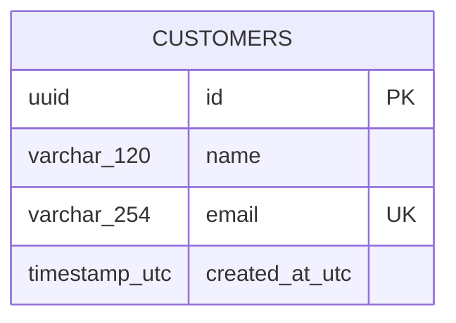

# Database design

The initial EF Core migration is under `backend/src/Starter.Infrastructure/Migrations`. The database contains ASP.NET Identity tables and this sample entity:

Identity tables use EF Core defaults. The sample customer has no relationship to users. Email has a unique database index; the API normalizes it to lowercase. Timestamps are UTC. Replace or extend this design for each real business module, recording primary keys, foreign keys, unique constraints, query indexes, delete behavior, and retention rules.
